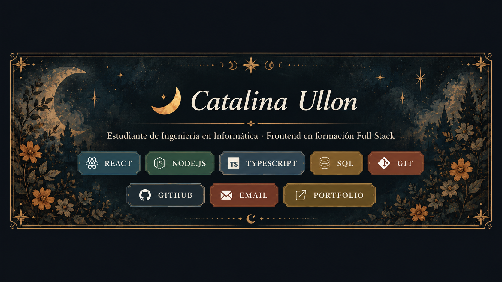
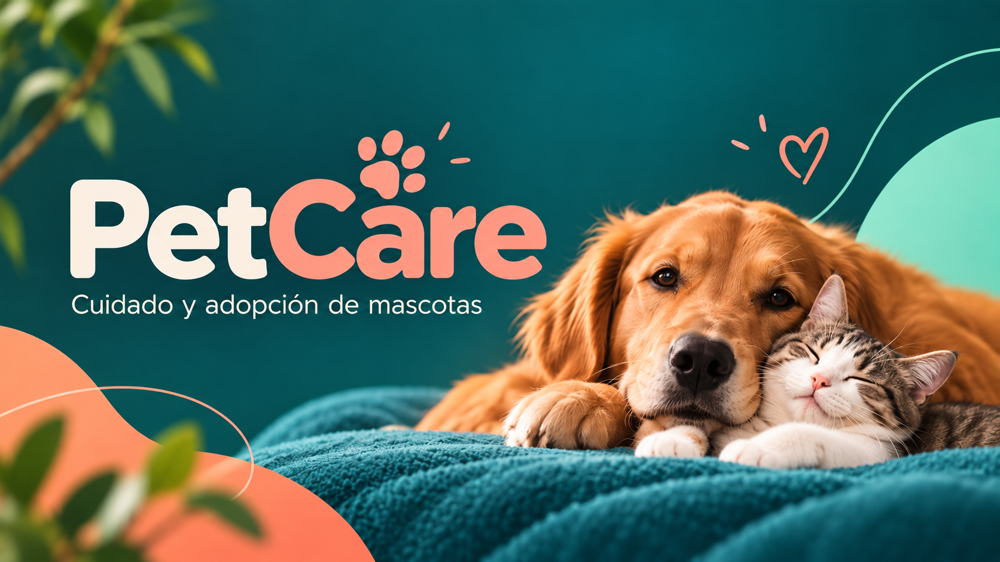

  <!-- Banner principal -->
  

  <!-- Tarjeta principal con tu información -->
  

<h2 align="center">✨ <i>Sobre mí</i></h2>

  <i>
   
 Soy estudiante de Ingeniería en Informática, con experiencia práctica en desarrollo Frontend utilizando HTML, CSS y JavaScript. Actualmente estoy enfocada en seguir fortaleciendo mis conocimientos en Backend y desarrollo Full Stack.

    

Me interesa especialmente profundizar en bases de datos, APIs, integración de sistemas y lógica del lado del servidor. Para seguir mejorando, desarrollo pequeños proyectos personales que me permiten poner en práctica tanto mis habilidades de Frontend como los conceptos relacionados con Backend y bases de datos.

    

Mi objetivo es continuar creciendo hasta desenvolverme con solidez en el desarrollo Full Stack, combinando interfaces funcionales con sistemas bien estructurados y conectados a bases de datos..
  </i>

<h2 align="center">🌐 <i>Mi Portfolio</i></h2>

  <i>
    Tengo conocimientos en HTML, CSS y JavaScript aplicados al desarrollo Frontend, y actualmente continúo fortaleciendo mis habilidades mientras aprendo conceptos de Backend, APIs y bases de datos.
  </i>

  
   
  <b>Mi Portafolio</b>

<h2 align="center">📌 <i>Mis proyectos</i></h2>

<table align="center">
<tr>
<td width="50%" valign="top" align="center">

<h3>🧵 <i>HilArte</i></h3>

<!-- Imagen de HilArte -->

<i>Sitio web temático de productos artesanales desarrollado con HTML, CSS y Bootstrap.</i>

</td>

<td width="50%" valign="top" align="center">

<h3>🐾 <i>PetCare</i></h3>

<!-- Imagen de PetCare -->

<i>Proyecto académico colaborativo desarrollado para la gestión de solicitudes de adopción.</i>

</td>
</tr>
</table>

<h2 align="center">🚀 <i>Tecnologías en aprendizaje</i></h2>

  <i>Actualmente continúo fortaleciendo mis conocimientos en:</i>

<h2 align="center">🎯 <i>Objetivo profesional</i></h2>

  <i>
  Seguir desarrollando mis habilidades en programación, aplicando mis conocimientos de Frontend y profundizando en Backend, bases de datos, desarrollo web e integración de sistemas, con el objetivo de crecer progresivamente hacia un perfil Full Stack.
  </i>

 

  <i>
    🌙 Aprendiendo, creando y mejorando un proyecto a la vez.
  </i>

